# Anime Clip Studio

I generated this app for my own use, since I wasn't satisfied with the limited functionality of simpler apps like
HandBrake and didn't want to deal with heavier video editing software more than necessary. The app is based on
ffmpeg and mpv. Its main functionality is frame-accurate marking of clips on a single timeline and their batch export
(rendering several selected clips from one video file at the same time). The app offers a choice of all the major
codecs, the ability to burn in hardsubs, export video with the frame cropped, and also automatically export
screenshots and turn clips into gif/webp images. In the *Tools → External tools…* menu you can also add a script to
your own mpv to place markers while watching, which will be picked up by the app automatically when you open the
video file. Although the app mentions anime in its name, which is what I generated it for, I don't think there are
any restrictions on using it with any video files.

Windows 10 / 11 · English and Russian interface · free and open source ([GPL-3.0](LICENSE)) · a non-commercial
project: no ads, no accounts, no telemetry, and nothing is downloaded without your consent.

> **Disclaimer.** This app was created with the help of [Claude](https://claude.ai), an AI assistant by Anthropic.
> The author has no experience in software development. The program is provided as is, without any warranty
> (see the [license](LICENSE)); please report problems in [Issues](https://github.com/danhoc/anime-clip-studio/issues).

**[Русская версия →](README.ru.md)**

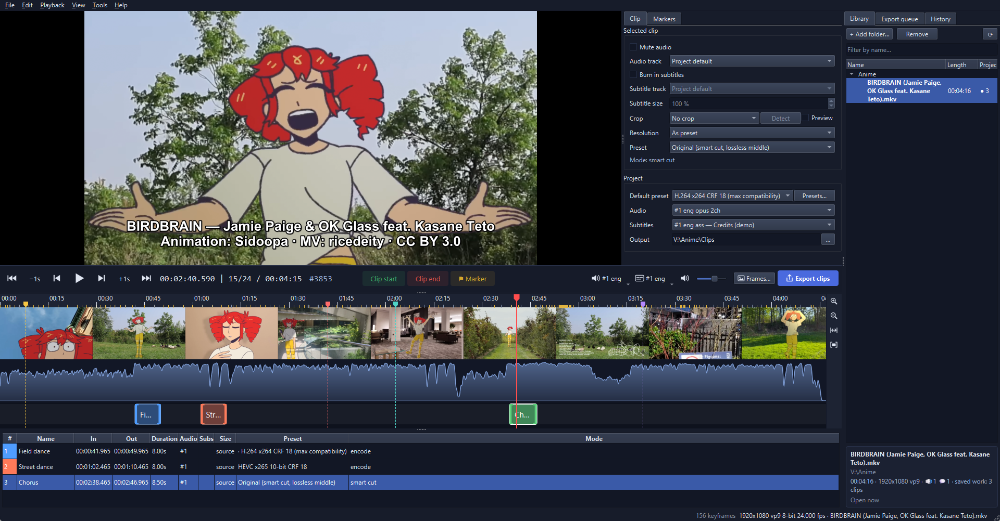

---

## Contents

- [Features](#features)
  - [Library](#library) · [Player and frame-accurate navigation](#player-and-frame-accurate-navigation) ·
    [Timeline](#timeline) · [Clips and their settings](#clips-and-their-settings) · [Shorts Mode](#shorts-mode) ·
    [Export](#export) · [Export presets](#export-presets) · [Frame extraction](#frame-extraction) ·
    [Marking while watching in mpv](#marking-while-watching-in-your-own-mpv) ·
    [Autosave and crash recovery](#autosave-and-crash-recovery) · [Updates](#updates) · [Interface](#interface)
- [Requirements](#requirements)
- [Installation](#installation): [simple (download)](#simple-installation-download) ·
  [advanced (Git)](#advanced-installation-git)
- [Updating and uninstalling](#updating-and-uninstalling)
- [Keyboard and mouse](#keyboard-and-mouse)
- [Troubleshooting](#troubleshooting)
- [Development](#development)
- [License and credits](#license-and-credits)

---

## Features

### Library

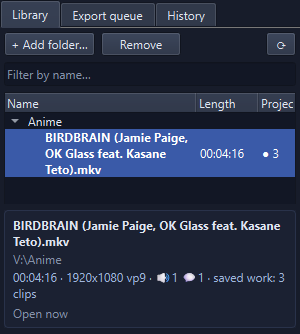

- Add folders with your episodes (**+ Add folder…**); they are scanned with all subfolders and watched for new files.
- Long release names wrap onto up to three lines. Clicking an episode opens a details box under the list with the
  full name, folder, duration, resolution, codec, number of audio / subtitle tracks and how many clips you have
  already saved for it.
- **●&nbsp;N** marks episodes with saved work. **Filter by name…** searches the whole library.
- Double-click (or Enter) opens an episode; **Ctrl+PgUp / Ctrl+PgDn** jump to the previous / next episode in the
  same folder. The context menu has *Extract frames…*, *Copy file name* and *Show in Explorer*.
- The side panel also holds the **Export queue** and the undo **History**; drag its edge to the window border to hide
  it completely (**Ctrl+L** brings the library back).

### Player and frame-accurate navigation

- Embedded **libmpv** player with GPU decoding: H.264, HEVC (also 10-bit), AV1, VP9 and everything else FFmpeg reads,
  in MKV, MP4, WebM, TS…
- An exact frame index is built from packet timestamps in the background, so stepping and cutting stay exact even
  for variable frame rate files. The time display shows `time | frame within the second / frames in that second`,
  then the absolute frame number (`#3853`) and `K` on keyframes.
- Arrow keys step through the video; the step of each modifier is set in *Settings*
  (defaults: **← / →** 1 second, **Shift+← / →** one frame, **Ctrl+← / →** previous / next keyframe).
  **↑ / ↓** jump between markers and clip edges, **J / K / L** shuttle backwards / pause / forwards faster.
- Audio track and subtitles for the preview are picked right in the bar under the video (the export uses each
  clip's own settings).

### Timeline

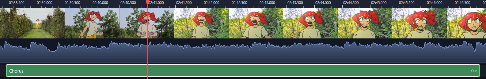

- Thumbnail strip, audio waveform (its detail adapts to the display) and keyframe ticks on the ruler.
- **Ctrl + wheel** zooms around the cursor down to single frames, the wheel scrolls; **Z** zooms to the selected clip,
  **Ctrl+0** shows the whole episode. Drag the playhead to an edge of a zoomed timeline to scroll it.
- **I** starts a clip, **O** ends it (the current frame is included), **M** adds a coloured marker. Any number of
  clips; overlapping clips go to extra lanes, which appear only while clips overlap.
- The *Markers* tab next to the player lists every marker with its time and name: click one to go to it,
  double-click a name to rename it, untick a marker to hide it from the timeline. On the timeline a marker's name
  shows when you point at it; clicking a marker goes to it there too. Hidden markers are skipped by **↑ / ↓** and
  clip edges do not snap to them.
- Drag a clip edge to move it: it snaps to frames, markers and keyframes (hold **Alt** to turn snapping off). Or
  right-click an edge, move the playhead and press **I** / **O** to set it again.
- Every change can be undone: **Ctrl+Z / Ctrl+Y**, the full list is in the *History* tab.

### Clips and their settings

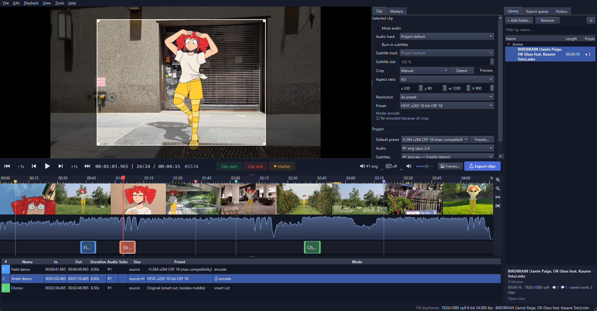

The table under the timeline lists all clips of the episode (double-click a name to rename it, double-click a row to
jump to the clip). The *Clip* tab next to the player holds the settings of the **selected clip**; select several
clips to change them together:

- **Mute audio** or pick another **audio track** (e.g. Japanese / dub).
- **Burn in subtitles**: any text track of the file, ASS styling and fonts embedded in the MKV included, with an
  adjustable **subtitle size** (signs placed in the picture keep their size).
- **Crop**: *Auto* detects black bars (**Detect** analyses ~10 frames), *Manual* lets you pick an aspect ratio
  (free, original, 16:9, 4:3, 1:1, 4:5, 9:16, 21:9) and drag / resize the frame right over the video, or type
  `x / y / w / h`. **Preview** shows the cropped picture in the player.
- **Resolution**: downscale only (standard heights or a custom one), or *As preset*.
- **Preset**: every clip may use its own export preset; the **Project** box below sets the default preset, audio
  track, subtitle track and output folder for all clips.
- An **ⓘ** line explains whether the clip will be cut losslessly or re-encoded, and why (crop, subtitles, scaling…).

### Shorts Mode

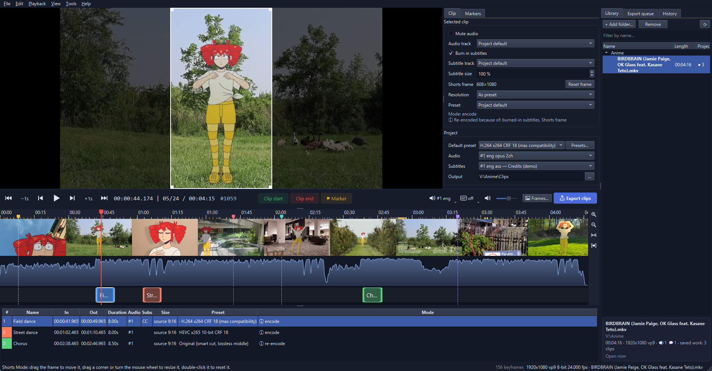

**Tools → Shorts Mode** gives every clip a vertical **9:16** frame for YouTube Shorts, TikTok or Reels:

- drag the frame to move it, drag a corner or turn the mouse wheel to resize it, double-click it to reset it;
- only the picture inside the frame is exported (608×1080 from a 1080p episode, or scaled by the preset);
- burned-in subtitles are scaled to the frame and placed at its bottom automatically;
- each clip keeps its own frame position; the crop tool is off while the mode is on (crops are kept).

### Export

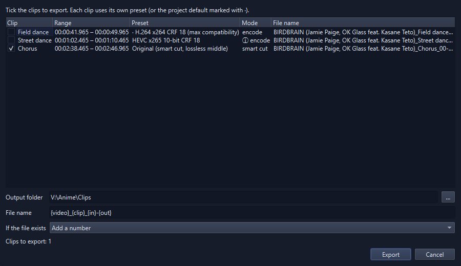

**Ctrl+E** exports all ticked clips at once; the jobs run in the **Export queue** with progress, cancel, retry and
*Open folder*.

- **Original (smart cut)**: only the incomplete GOPs at the clip edges are re-encoded, the middle is copied
  bit-exactly. The result is checked (frame count, full decode, PSNR at every splice); if anything is off the clip
  is re-encoded automatically instead.
- **Re-encoding** with x264, x265, SVT-AV1, libaom, VP9, VVC (experimental) or **NVENC** on NVIDIA GPUs (H.264,
  HEVC, AV1), 8 or 10-bit, CRF / CQ quality, the `animation` tune, MP4 / MKV / WebM.
- **Target size** presets (two-pass) with optional automatic downscaling, e.g. *Discord 10 MB / 50 MB*.
- **GIF** and **animated WebP** with quality presets and *fit into N MB*: frame rate, size and colours are lowered
  step by step until the file fits; any parameter can be locked or given a minimum.
- File names from a template: `{video} {clip} {n} {in} {out} {preset}`; existing files get a number, are
  overwritten or skipped. Several CPU and GPU jobs can run in parallel (*Settings*).

### Export presets

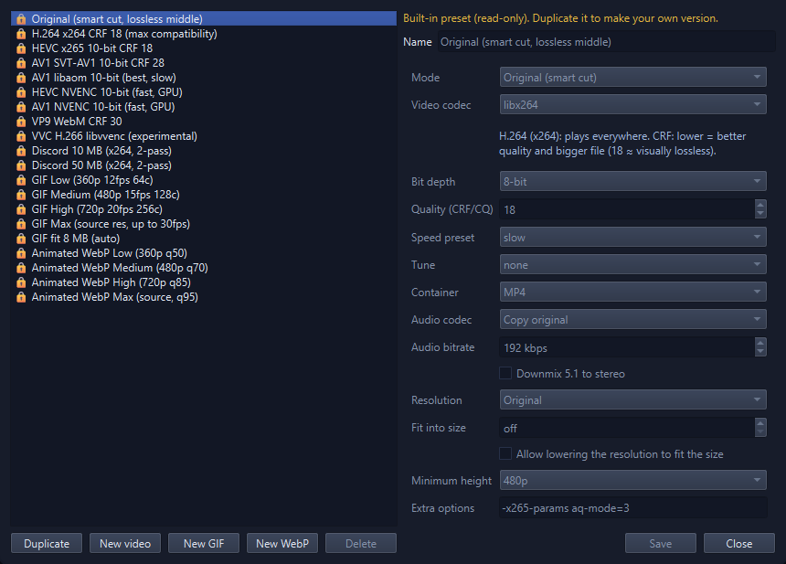

**Tools → Export presets…** (or **Presets…** in the *Project* box). Built-in presets are read-only;
**Duplicate** one or start a **New video / GIF / WebP** preset to make your own.

| Built-in preset | What it is for |
|---|---|
| Original (smart cut, lossless middle) | source quality, fastest |
| H.264 x264 CRF 18 | plays everywhere (the default) |
| HEVC x265 10-bit CRF 18 · AV1 SVT-AV1 10-bit CRF 28 · AV1 libaom 10-bit | smaller files, smooth gradients |
| HEVC / AV1 NVENC 10-bit | fast encoding on NVIDIA GPUs |
| VP9 WebM CRF 30 · VVC H.266 (experimental) | web / newest codec |
| Discord 10 MB / 50 MB | fits the upload limit (two-pass, auto downscale) |
| GIF Low / Medium / High / Max, GIF fit 8 MB | 360p…source, 12–30 fps, 64–256 colours |
| Animated WebP Low / Medium / High / Max | 360p…source, quality 50–95 |

### Frame extraction

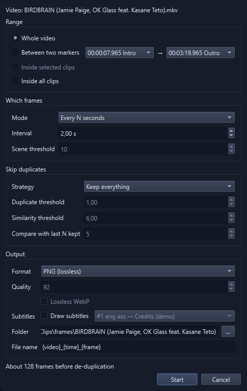

**Ctrl+Shift+E** (or **Frames…**) saves many frames at once — for wallpapers, references, screenshot threads:

- range: the whole video, between two markers, inside the selected clips or inside all clips;
- one frame every N seconds, or one per scene change (adjustable sensitivity);
- skip duplicates: anime has many static shots, so exact and near duplicates (or all similar neighbouring frames)
  can be dropped, comparing with the last N kept frames;
- PNG (8-bit or 16-bit that keeps 10-bit detail), JPEG, WebP (also lossless); subtitles can be drawn in;
- file names from `{video} {time} {frame}`; an interrupted run resumes where it stopped.

### Marking while watching in your own mpv

*Tools → External tools… → mpv.exe (optional)* → **Install marker script into mpv** copies
[`acs_markers.lua`](src/acs/mpv/acs_markers.lua) into the scripts folder that your mpv reports itself (portable
or `%APPDATA%\mpv` setups both work). Then, while watching in mpv:

| Key | Action |
|---|---|
| Alt+M | marker at the current frame |
| Alt+I / Alt+O | clip start / clip end |
| Alt+Backspace | undo the last mark |
| Alt+L | list the marks of this file |

When you open the same episode in Anime Clip Studio it offers to **import** the marks (start / end pairs become
clips) or clear them; *File → Import marks from mpv…* does the same on demand. Files are matched by full path, or by
name and size if they were moved. The keys can be changed in the same dialog or in mpv's `input.conf`.

### Autosave and crash recovery

- Work is saved automatically: reopen an episode and its clips come back. **Ctrl+S** also saves a project file
  (`.acsproj`) you can keep anywhere or move to another PC.
- Snapshots are taken before long tasks; after a crash or power loss the app offers to restore your work, and an
  unfinished export queue continues where it stopped.
- Starting a second window asks first, so two windows do not overwrite each other's settings by accident.

### Updates

*Help → Check for updates…* asks GitHub whether a newer version exists and shows what is new. Nothing is downloaded
until you press **Download and install**:

- a copy downloaded as a ZIP is compared with the latest [release](https://github.com/danhoc/anime-clip-studio/releases);
  the update downloads it, checks the archive and replaces the program files — `.venv`, `vendor` (FFmpeg, libmpv)
  and your projects, presets and settings stay as they are;
- a copy installed with Git shows the new commits of its branch and updates with `git pull --ff-only` (refused while
  tracked files have local changes);
- afterwards the app restarts through `run.bat`, which installs changed libraries before starting.

The app never checks by itself and sends nothing except the request for the latest version.

### Interface

| 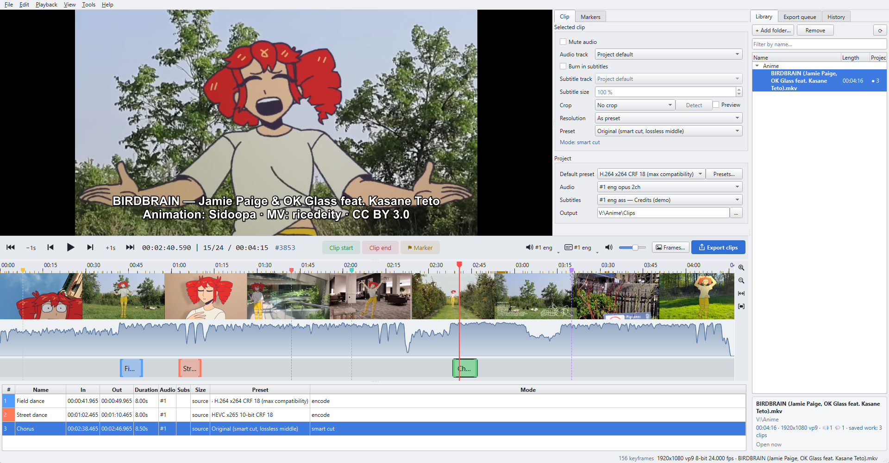 | 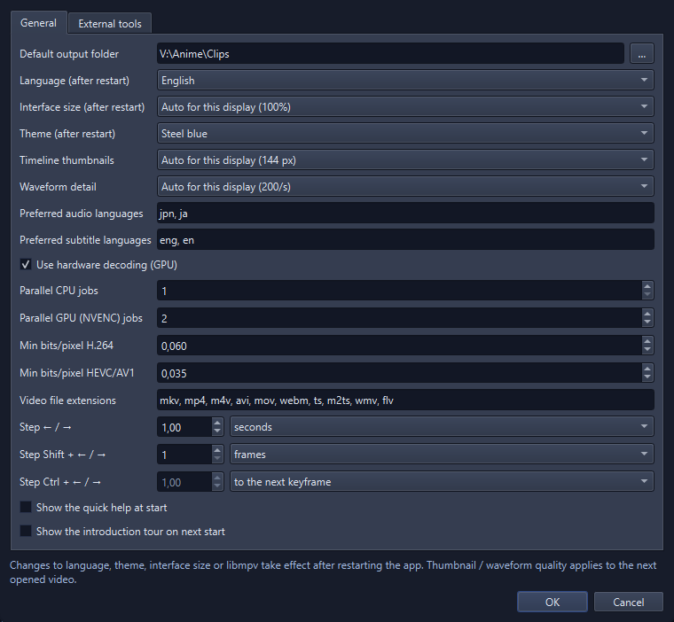 |
|---|---|
| Dark and light theme | *Tools → Settings…* |
| 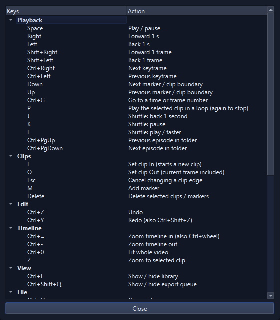 | 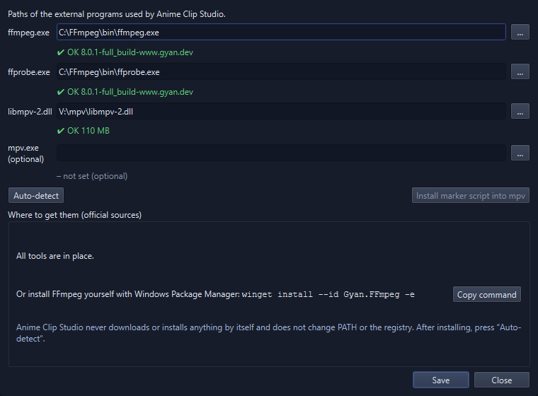 |
| **F1** lists every key | *Tools → External tools…* |

- English and Russian (*Settings → Language*), dark / light / system theme, interface size 100–200 %.
- The layout fits Full HD screens: the bar under the video stays in one row, panels can be hidden completely
  (drag their edge to the window border or use the *View* menu) and come back with their last size.
- An introduction tour on the first start, *Help → Quick help* with the main keys, tooltips everywhere.

---

## Requirements

| Component | Version | Needed for | Where to get it |
|---|---|---|---|
| **Windows** | 10 (1809 or newer) or 11, 64-bit | — | — |
| **uv** | current version (tested with 0.11) | installs Python and the libraries | <https://docs.astral.sh/uv/getting-started/installation/> or `winget install --id astral-sh.uv -e` |
| **Python** | 3.13.x | runs the app | installed automatically by uv (no separate installation needed) |
| PySide6 · python-mpv · numpy · platformdirs | ≥ 6.8 · ≥ 1.0.7 · ≥ 2.1 · ≥ 4.3 (tested: 6.12, 1.0.8, 2.5, 4.13) | interface, player binding | installed automatically by uv from [`uv.lock`](uv.lock) |
| **FFmpeg** (`ffmpeg.exe` + `ffprobe.exe`) | 7.1 or newer recommended (tested with 8.0.1), a *full* build for all encoders | export, frame extraction, analysis | <https://ffmpeg.org/download.html> → Windows builds by [gyan.dev](https://www.gyan.dev/ffmpeg/builds/) (`ffmpeg-release-full.7z`) or [BtbN](https://github.com/BtbN/FFmpeg-Builds/releases); or `winget install --id Gyan.FFmpeg -e` |
| **libmpv** (`libmpv-2.dll`, 64-bit) | from mpv 0.35 or newer (tested with 0.40) | the video player | <https://mpv.io/installation/> → [libmpv builds for Windows](https://sourceforge.net/projects/mpv-player-windows/files/libmpv/) (`mpv-dev-x86_64-….7z`) or [shinchiro builds](https://github.com/shinchiro/mpv-winbuild-cmake/releases) |
| mpv player (`mpv.exe`) | any recent | *optional*: marking while watching | <https://mpv.io/installation/> |
| NVIDIA GPU | GeForce GTX 10xx or newer for HEVC NVENC, RTX 40xx for AV1 NVENC | *optional*: NVENC presets | — |

The app finds FFmpeg and libmpv by itself in the `vendor` folder, `PATH`, winget / scoop / chocolatey locations,
Program Files, `C:\FFmpeg` and `C:\mpv` (*Tools → External tools… → Auto-detect*). Missing encoders of a particular
FFmpeg build are listed in the same dialog. FFmpeg and libmpv are separate programs and are not part of this
repository (see [`vendor/README.md`](vendor/README.md)).

---

## Installation

### Simple installation (download)

1. Download the program: **[Releases](https://github.com/danhoc/anime-clip-studio/releases)** → *Source code
   (zip)* of the latest version, or the green **Code** button → **Download ZIP**.
2. Right-click the downloaded ZIP → *Properties* → tick **Unblock** → *OK* (otherwise Windows asks about every
   script). Unpack it to a folder of your choice, e.g. `C:\Programs\AnimeClipStudio`.
3. Double-click **`install.bat`**. It:
   - offers to install **uv** with winget if it is missing (or tells you where to get it);
   - installs Python 3.13 and the libraries into the program folder (`.venv`, about 700 MB; first time a few minutes);
   - looks for **FFmpeg** and **libmpv** and, if they are missing, offers to install FFmpeg with winget and opens the
     libmpv download page;
   - can create a desktop shortcut.

   Nothing is installed without asking, and nothing outside the program folder is changed except what you agree to
   (uv, FFmpeg, the shortcut).
4. **libmpv**, if `install.bat` did not find it: download `mpv-dev-x86_64-<date>.7z` from the
   [libmpv page](https://sourceforge.net/projects/mpv-player-windows/files/libmpv/), open it with
   [7-Zip](https://www.7-zip.org/) and put **`libmpv-2.dll`** into the `vendor` folder of the program.
5. Start the app with **`run.bat`** (or the shortcut). On the first start add a folder with your episodes in the
   Library and follow the short tour.

### Advanced installation (Git)

```bat
winget install --id astral-sh.uv -e           :: or see https://docs.astral.sh/uv/
winget install --id Gyan.FFmpeg -e            :: or any FFmpeg build in PATH / vendor
git clone https://github.com/danhoc/anime-clip-studio.git
cd anime-clip-studio
uv sync                                        :: Python 3.13 + dependencies into .venv
copy <path>\libmpv-2.dll vendor\
run.bat                                        :: or: uv run python -m acs [video or .acsproj]
```

`run_debug.bat` starts a diagnostic session: verbose event trace, full libmpv log and console output in
`%APPDATA%\AnimeClipStudio\logs`.

---

## Updating and uninstalling

- **Update**: *Help → Check for updates…* (see [Updates](#updates)). By hand: `git pull` and `uv sync` (Git), or
  download the new ZIP, unpack it over the old folder (keep `vendor`) and run `install.bat` again. Projects, presets
  and settings are kept, they live outside the program folder.
- **Uninstall**: delete the program folder, the desktop shortcut and, if you do not need your settings and autosaves,
  `%APPDATA%\AnimeClipStudio` and `%LOCALAPPDATA%\AnimeClipStudio` (thumbnail / waveform cache). uv and FFmpeg can be
  removed with `winget uninstall astral-sh.uv` / `winget uninstall Gyan.FFmpeg`.

---

## Keyboard and mouse

| Key | Action | Key | Action |
|---|---|---|---|
| Space | play / pause | I / O | clip start / end (starts a new clip) |
| ← / → | back / forward (1 s by default) | M | add marker |
| Shift+← / → | one frame (by default) | Delete | delete selected clips / markers |
| Ctrl+← / → | previous / next keyframe (by default) | Esc | cancel changing a clip edge |
| ↑ / ↓ | previous / next marker or clip edge | Ctrl+Z / Ctrl+Y | undo / redo |
| J / K / L | shuttle back / pause / play faster | Z | zoom to selected clip |
| Ctrl+PgUp / PgDn | previous / next episode in folder | Ctrl+= / Ctrl+- / Ctrl+0 | zoom in / out / whole video |
| Ctrl+O / Ctrl+Shift+O | open video / project | Ctrl+L | show / hide library |
| Ctrl+S / Ctrl+Shift+S | save project / save as | Ctrl+Shift+Q | show / hide export queue |
| Ctrl+E | export clips | F1 | all keyboard shortcuts |
| Ctrl+Shift+E | extract frames | S | save the current frame as an image |
| Ctrl+G | go to a time or frame number | P | play the selected clip in a loop |

| Mouse | Action |
|---|---|
| Ctrl + wheel | zoom timeline around the cursor |
| Wheel / Shift + wheel | scroll timeline |
| Click / drag on timeline | seek (scrub) |
| Drag clip edge | move In / Out (snaps to frames, markers, keyframes; Alt disables snapping) |
| Right-click clip edge | change that edge with the playhead, then press I / O |
| Ctrl + click clip | add clip to selection |
| Double-click clip | jump to clip start |
| Click a marker | go to it (drag it to move it) |
| Point at a marker | show its name |
| Double-click the time display | go to a time or frame number |
| Drag the frame over the video | move the Shorts frame or the manual crop |
| Drag a frame corner / edge, or wheel | resize it (a chosen aspect ratio is kept) |
| Double-click the frame | reset it to the largest size |

---

## Troubleshooting

- **"Windows protected your PC" / a security warning for `install.bat` or `run.bat`**: unblock the ZIP before
  unpacking (step 2 above), or click *More info → Run anyway*. The scripts are plain text, you can read them first.
- **The player stays black / "libmpv could not be started"**: check *Tools → External tools…*; `libmpv-2.dll` must be
  the 64-bit build. Restart the app after changing it.
- **A preset says "this build lacks: …"**: your FFmpeg build has no such encoder (e.g. `libvvenc`, `libsvtav1`) —
  use a *full* build from gyan.dev or BtbN.
- **Something else**: start `run_debug.bat`, reproduce the problem and attach the files from
  `%APPDATA%\AnimeClipStudio\logs` to an issue.

---

## Development

```bat
uv sync
uv run pytest            :: fast unit tests
uv run pytest -m slow    :: integration tests (need ffmpeg; encode synthetic clips)
```

```
src/acs/core   media logic without UI: probe, frame index, smart cut, ffmpeg commands, export / frames
               runners, job queue, project files, recovery, presets, Shorts / crop geometry, tools detection
src/acs/ui     PySide6 widgets: main window, player (libmpv), timeline, panels, dialogs, tour
src/acs/i18n   English source strings + Russian dictionary (ru.py)
src/acs/mpv    marker script for a stand-alone mpv
tests          pytest suite
```

Every visible string goes through `tr()` with the English text as the key and needs a Russian translation in
`src/acs/i18n/ru.py`; `tests/test_i18n.py` fails when one is missing.

Data locations: settings, presets, autosaves and logs in `%APPDATA%\AnimeClipStudio`, thumbnail / waveform cache in
`%LOCALAPPDATA%\AnimeClipStudio\Cache`.

**Publishing a version** (so that *Check for updates* finds it): set `GITHUB_REPO` in
[`src/acs/__init__.py`](src/acs/__init__.py) to `owner/repository` once, raise `__version__` there and `version` in
`pyproject.toml`, commit, then create a GitHub release with the tag `v<version>` (e.g. `v0.2.0`). Its description is
shown to users as "What is new".

On Windows the app does not enable Python's `faulthandler`: LuaJIT inside libmpv raises SEH exceptions as normal
control flow and faulthandler reacting to them corrupts the interpreter.

---

## License and credits

Anime Clip Studio is free software: you can redistribute it and/or modify it under the terms of the
**GNU General Public License, version 3 or later** — see [LICENSE](LICENSE).

Libraries installed by uv keep their own licenses: PySide6 / Qt (LGPL-3.0), python-mpv (GPL-2.0+ or LGPL-2.1+),
numpy (BSD-3-Clause), platformdirs (MIT). FFmpeg and mpv / libmpv are separate programs under LGPL / GPL (depending
on the build) and are not part of this repository. A ready-made archive passed on by the author may already contain
`vendor/libmpv-2.dll` (the mpv build by shinchiro, GPL, redistributed unmodified); its license texts, exact version
and links to the source code are in `vendor/licenses/mpv`. Such archives are made with
[`packaging/make_dist.py`](packaging/make_dist.py).

**Screenshots** show frames from the music video
[*BIRDBRAIN (w/ OK Glass) feat. Kasane Teto*](https://www.youtube.com/watch?v=0iVlSNpq8i8) by **Jamie Paige**
(music: Jamie Paige & OK Glass, animation: Sidoopa with Púca O'Donnell, music video: ricedeity), licensed under
[CC BY 3.0](https://creativecommons.org/licenses/by/3.0/) ([Wikimedia Commons copy](https://commons.wikimedia.org/wiki/File:BIRDBRAIN_(w_OK_Glass)_feat._Kasane_Teto.webm)).
Kasane Teto © TwinDrill. The subtitle line in the screenshots was added for the demonstration.
