# Anime Clip Studio

**Покадровая нарезка клипов и массовая выгрузка кадров из серий аниме, которые хранятся у вас на компьютере.**
Размечайте сколько угодно клипов на одном таймлайне, выгружайте их без потери качества (smart cut) или
перекодируйте для Discord, YouTube Shorts, в GIF или WebP, сохраняйте сотни кадров с отсевом дублей.

Windows 10 / 11 · интерфейс на русском и английском · бесплатно, с открытым кодом ([GPL-3.0](LICENSE)) ·
некоммерческий проект: без рекламы, регистрации и телеметрии, без вашего согласия ничего не скачивается.

> **Дисклеймер.** Приложение создано с помощью [Claude](https://claude.ai) — ИИ-ассистента компании Anthropic.
> У автора нет опыта в разработке программного обеспечения. Программа распространяется «как есть», без каких-либо
> гарантий (см. [лицензию](LICENSE)); о проблемах пишите в [Issues](https://github.com/USERNAME/anime-clip-studio/issues).

**[English version →](README.md)**

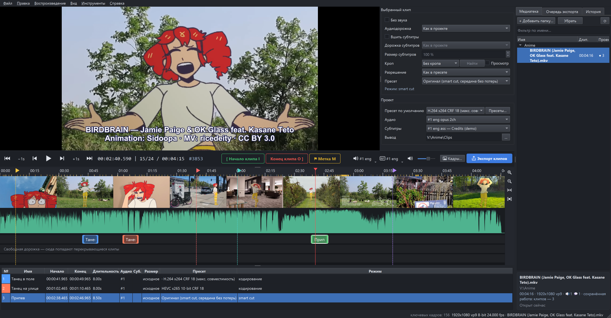

---

## Содержание

- [Возможности](#возможности)
  - [Медиатека](#медиатека) · [Плеер и покадровая навигация](#плеер-и-покадровая-навигация) ·
    [Таймлайн](#таймлайн) · [Клипы и их настройки](#клипы-и-их-настройки) · [Режим Shorts](#режим-shorts) ·
    [Экспорт](#экспорт) · [Пресеты экспорта](#пресеты-экспорта) · [Выгрузка кадров](#выгрузка-кадров) ·
    [Метки при просмотре в mpv](#метки-при-просмотре-в-своём-mpv) ·
    [Автосохранение и восстановление](#автосохранение-и-восстановление-после-сбоя) · [Обновления](#обновления) ·
    [Интерфейс](#интерфейс)
- [Системные требования](#системные-требования)
- [Установка](#установка): [простая (скачать)](#простая-установка-скачать) · [для продвинутых (Git)](#установка-через-git)
- [Обновление и удаление](#обновление-и-удаление)
- [Клавиатура и мышь](#клавиатура-и-мышь)
- [Если что-то не работает](#если-что-то-не-работает)
- [Разработка](#разработка)
- [Лицензия и благодарности](#лицензия-и-благодарности)

---

## Возможности

### Медиатека

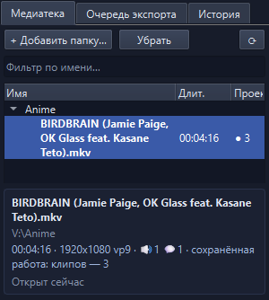

- Добавьте папки с сериями (**+ Добавить папку…**): они просматриваются вместе со всеми подпапками, новые файлы
  появляются сами.
- Длинные имена релизов переносятся до трёх строк. По клику на серию под списком открывается окно с подробностями:
  полное имя, папка, длительность, разрешение, кодек, число аудиодорожек и субтитров, сколько клипов уже сохранено.
- **●&nbsp;N** отмечает серии с сохранённой работой. **Фильтр по имени…** ищет по всей медиатеке.
- Двойной щелчок (или Enter) открывает серию; **Ctrl+PgUp / Ctrl+PgDn** — предыдущая / следующая серия в той же
  папке. В контекстном меню — *Выгрузить кадры…*, *Копировать имя файла* и *Показать в Проводнике*.
- На той же боковой панели — **Очередь экспорта** и **История** правок; перетащите край панели к краю окна, чтобы
  скрыть её полностью (**Ctrl+L** вернёт медиатеку).

### Плеер и покадровая навигация

- Встроенный плеер **libmpv** с аппаратным декодированием: H.264, HEVC (в том числе 10-бит), AV1, VP9 и всё, что
  читает FFmpeg, в MKV, MP4, WebM, TS…
- Точный индекс кадров строится в фоне по временным меткам пакетов, поэтому шаги и резы точны даже для файлов
  с переменной частотой кадров. Время показано как `время | кадр внутри секунды / кадров в этой секунде`, затем
  абсолютный номер кадра (`#3853`) и `K` на ключевых кадрах.
- Стрелки двигают видео, шаг для каждого модификатора задаётся в *Настройках* (по умолчанию: **← / →** — 1 секунда,
  **Shift+← / →** — один кадр, **Ctrl+← / →** — предыдущий / следующий ключевой кадр). **↑ / ↓** — переход между
  метками и границами клипов, **J / K / L** — назад / пауза / вперёд быстрее.
- Аудиодорожка и субтитры для просмотра выбираются прямо в строке под видео (экспорт берёт настройки каждого клипа).

### Таймлайн

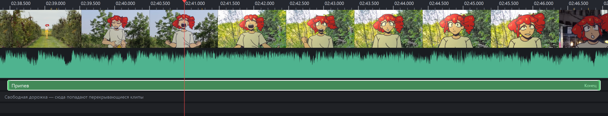

- Полоса миниатюр, звуковая волна (детализация подстраивается под экран) и отметки ключевых кадров на линейке.
- **Ctrl + колесо** приближает вокруг курсора вплоть до отдельных кадров, колесо прокручивает; **Z** — приблизить
  к выбранному клипу, **Ctrl+0** — показать всё видео. Подведите указатель воспроизведения к краю приближенного
  таймлайна, и он прокрутится.
- **I** начинает клип, **O** заканчивает (текущий кадр входит в клип), **M** ставит цветную метку. Клипов сколько
  угодно, перекрывающиеся клипы раскладываются по дополнительным дорожкам.
- Край клипа можно тянуть мышью: он прилипает к кадрам, меткам и ключевым кадрам (**Alt** отключает прилипание).
  Или щёлкните по краю правой кнопкой, переведите указатель и нажмите **I** / **O**.
- Любое действие отменяется: **Ctrl+Z / Ctrl+Y**, полный список — на вкладке *История*.

### Клипы и их настройки

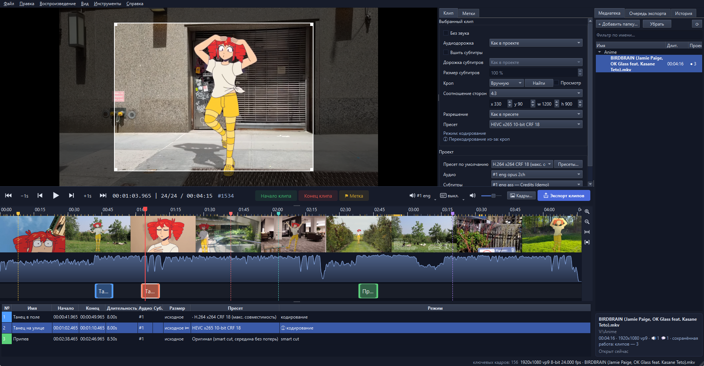

Таблица под таймлайном — все клипы серии (двойной щелчок по имени — переименовать, по строке — перейти к клипу).
В колонке рядом с плеером — настройки **выбранного клипа**; выделите несколько клипов, чтобы менять их вместе:

- **Без звука** или другая **аудиодорожка** (например, японская / озвучка).
- **Вшить субтитры**: любая текстовая дорожка файла, со стилями ASS и шрифтами, вложенными в MKV, и настраиваемым
  **размером субтитров** (надписи, размещённые в кадре, сохраняют свой размер).
- **Кроп**: *Авто* находит чёрные полосы (**Найти** анализирует ~10 кадров), *Вручную* — выберите соотношение
  сторон (свободное, исходное, 16:9, 4:3, 1:1, 4:5, 9:16, 21:9) и двигайте / меняйте рамку прямо поверх видео или
  введите `x / y / w / h`. Флажок **Просмотр** показывает обрезанную картинку в плеере.
- **Разрешение**: только уменьшение (стандартные высоты или своя) или *Как в пресете*.
- **Пресет**: у каждого клипа может быть свой пресет экспорта; блок **Проект** ниже задаёт пресет по умолчанию,
  аудиодорожку, субтитры и папку вывода для всех клипов.
- Строка **ⓘ** объясняет, будет ли клип вырезан без потерь или перекодирован и почему (кроп, субтитры, масштаб…).

### Режим Shorts

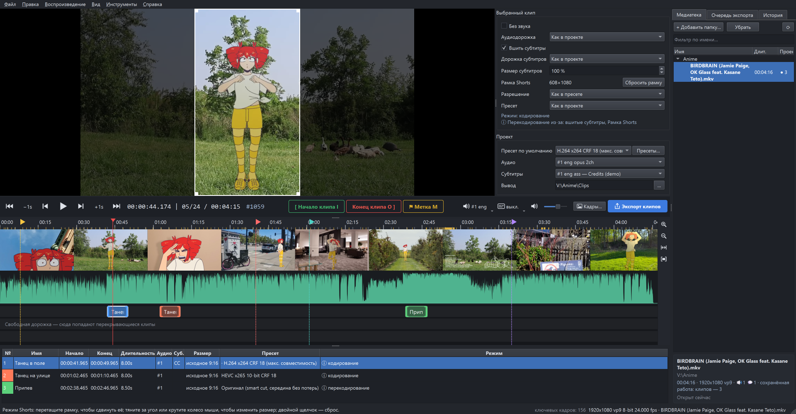

**Инструменты → Режим Shorts** даёт каждому клипу вертикальную рамку **9:16** для YouTube Shorts, TikTok или Reels:

- тяните рамку, чтобы сдвинуть её, тяните угол или крутите колесо мыши, чтобы изменить размер, двойной щелчок —
  сброс;
- экспортируется только картинка внутри рамки (608×1080 из серии 1080p или с масштабом из пресета);
- вшитые субтитры автоматически масштабируются под рамку и ставятся у её нижнего края;
- у каждого клипа своё положение рамки; пока режим включён, кроп недоступен (сами настройки кропа сохраняются).

### Экспорт

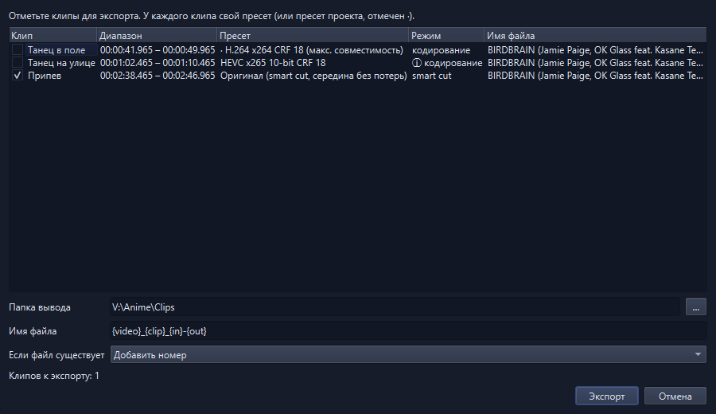

**Ctrl+E** выгружает все отмеченные клипы разом; задания выполняются в **Очереди экспорта** с прогрессом, отменой,
повтором и кнопкой *Открыть папку*.

- **Оригинал (smart cut)**: перекодируются только неполные GOP по краям клипа, середина копируется бит в бит.
  Результат проверяется (число кадров, полное декодирование, PSNR на каждом стыке); если что-то не так, клип
  автоматически перекодируется целиком.
- **Перекодирование**: x264, x265, SVT-AV1, libaom, VP9, VVC (экспериментально) или **NVENC** на видеокартах NVIDIA
  (H.264, HEVC, AV1), 8 или 10 бит, качество CRF / CQ, настройка `animation`, контейнеры MP4 / MKV / WebM.
- Пресеты **под размер файла** (два прохода) с автоматическим уменьшением разрешения, например *Discord 10 МБ / 50 МБ*.
- **GIF** и **анимированный WebP** с пресетами качества и режимом *уложиться в N МБ*: частота кадров, размер и число
  цветов понижаются по шагам, пока файл не влезет; любой параметр можно закрепить или задать ему минимум.
- Имена файлов по шаблону `{video} {clip} {n} {in} {out} {preset}`; если файл уже есть — добавить номер,
  перезаписать или пропустить. Несколько заданий на процессоре и видеокарте могут идти параллельно (*Настройки*).

### Пресеты экспорта

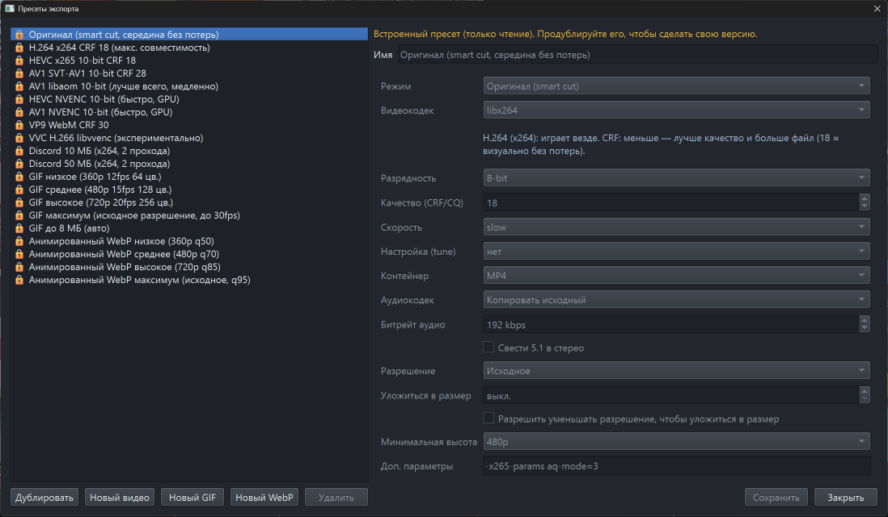

**Инструменты → Пресеты экспорта…** (или **Пресеты…** в блоке *Проект*). Встроенные пресеты только для чтения:
**Дублировать** любой или создать **Новый видео / GIF / WebP**, чтобы сделать свой.

| Встроенный пресет | Для чего |
|---|---|
| Оригинал (smart cut, середина без потерь) | исходное качество, быстрее всего |
| H.264 x264 CRF 18 (макс. совместимость) | играет везде (по умолчанию) |
| HEVC x265 10-bit CRF 18 · AV1 SVT-AV1 10-bit CRF 28 · AV1 libaom 10-bit | файлы меньше, плавные градиенты |
| HEVC / AV1 NVENC 10-bit | быстрое кодирование на видеокартах NVIDIA |
| VP9 WebM CRF 30 · VVC H.266 (экспериментально) | для веба / новейший кодек |
| Discord 10 МБ / 50 МБ | укладывается в лимит загрузки (два прохода, авто-уменьшение) |
| GIF Low / Medium / High / Max, GIF до 8 МБ | от 360p до исходного, 12–30 к/с, 64–256 цветов |
| Анимированный WebP Low / Medium / High / Max | от 360p до исходного, качество 50–95 |

### Выгрузка кадров

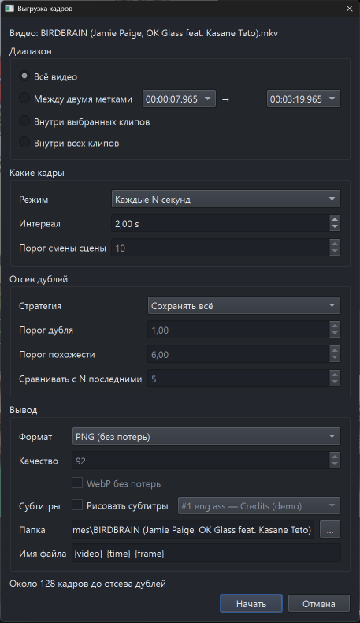

**Ctrl+Shift+E** (или **Кадры…**) сохраняет много кадров за раз — для обоев, референсов, скриншотов:

- диапазон: всё видео, между двумя метками, внутри выбранных клипов или внутри всех клипов;
- кадр каждые N секунд или по одному на смену сцены (чувствительность настраивается);
- отсев дублей: в аниме много статичных планов, поэтому можно убирать полные и почти полные дубли (или все похожие
  соседние кадры), сравнивая с последними N сохранёнными;
- PNG (8 бит или 16 бит с сохранением 10-битной точности), JPEG, WebP (в том числе без потерь); можно рисовать субтитры;
- имена по шаблону `{video} {time} {frame}`; прерванная выгрузка продолжается с того же места.

### Метки при просмотре в своём mpv

*Инструменты → Внешние программы… → mpv.exe (необязательно)* → **Установить скрипт меток в mpv** копирует
[`acs_markers.lua`](src/acs/mpv/acs_markers.lua) в папку скриптов, которую сообщает сам mpv (подходят и
портативная сборка, и `%APPDATA%\mpv`). Дальше при просмотре в mpv:

| Клавиша | Действие |
|---|---|
| Alt+M | метка на текущем кадре |
| Alt+I / Alt+O | начало / конец клипа |
| Alt+Backspace | отменить последнюю метку |
| Alt+L | показать метки этого файла |

Когда вы откроете ту же серию в Anime Clip Studio, программа предложит **импортировать** метки (пары
начало / конец станут клипами) или удалить их; *Файл → Импортировать метки из mpv…* делает то же по запросу.
Файлы сопоставляются по полному пути, а если их переместили — по имени и размеру. Клавиши можно поменять в том же
окне или в `input.conf` вашего mpv.

### Автосохранение и восстановление после сбоя

- Работа сохраняется сама: откройте серию снова — клипы на месте. **Ctrl+S** дополнительно сохраняет файл проекта
  (`.acsproj`), который можно хранить где угодно и переносить на другой компьютер.
- Перед долгими задачами делаются снимки; после сбоя или отключения питания программа предложит восстановить работу,
  а незавершённая очередь экспорта продолжится с того же места.
- Запуск второго окна требует подтверждения, чтобы два окна случайно не перезаписали настройки друг друга.

### Обновления

*Справка → Проверить обновления…* спрашивает у GitHub, есть ли новая версия, и показывает, что в ней нового. Ничего не
скачивается, пока вы не нажмёте **Скачать и установить**:

- копия, скачанная архивом ZIP, сравнивается с последним [выпуском](https://github.com/USERNAME/anime-clip-studio/releases);
  обновление скачивает его, проверяет архив и заменяет файлы программы — `.venv`, `vendor` (FFmpeg, libmpv), ваши
  проекты, пресеты и настройки остаются как есть;
- копия, установленная через Git, показывает новые коммиты своей ветки и обновляется командой `git pull --ff-only`
  (если в отслеживаемых файлах есть локальные изменения, обновление не выполняется);
- после этого программа перезапускается через `run.bat`, который перед запуском доустанавливает изменившиеся
  библиотеки.

Сама программа обновления не проверяет и ничего не отправляет, кроме запроса последней версии.

### Интерфейс

| 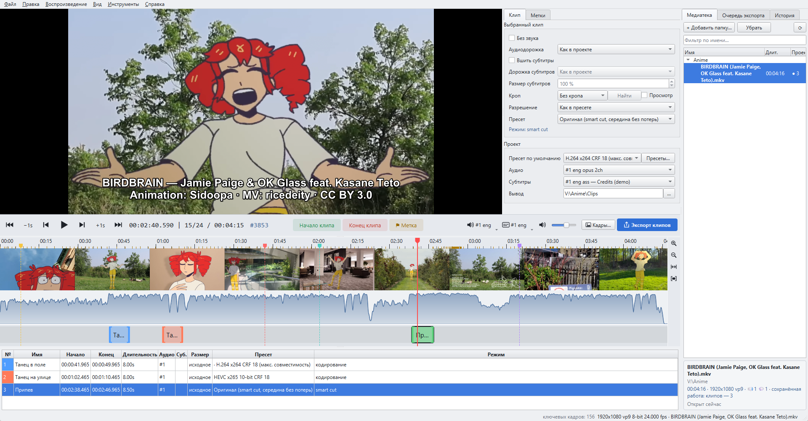 | 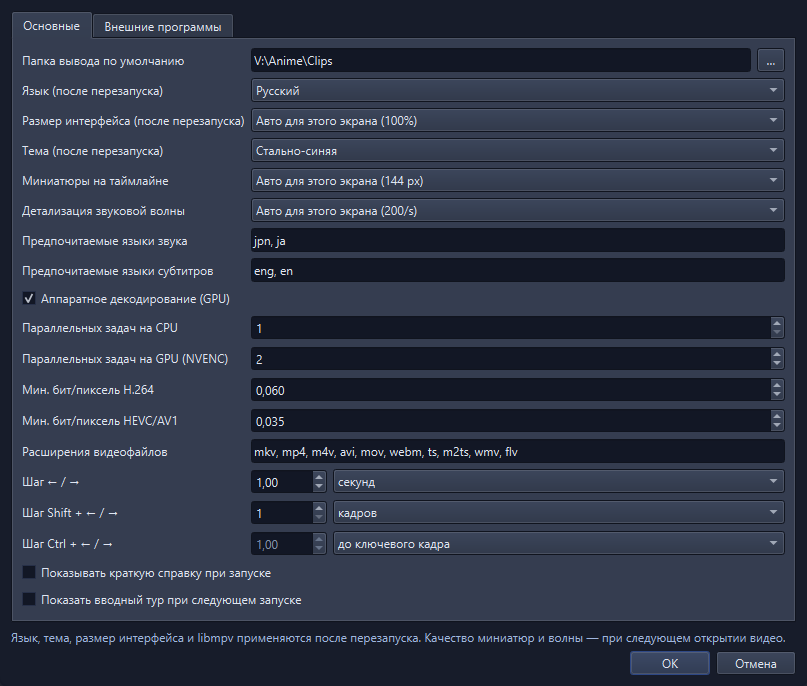 |
|---|---|
| Тёмная и светлая тема | *Инструменты → Настройки…* |
| 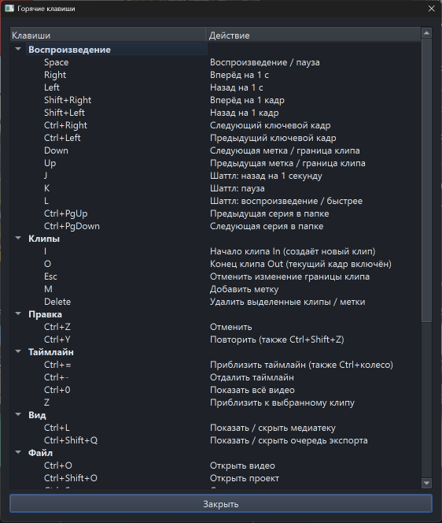 | 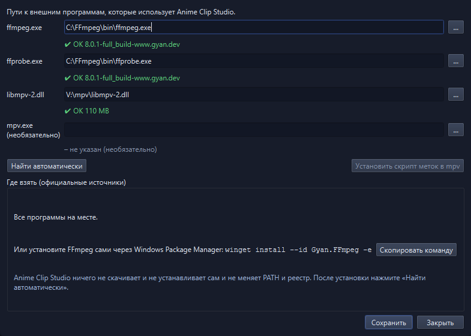 |
| **F1** — все клавиши | *Инструменты → Внешние программы…* |

- Русский и английский язык (*Настройки → Язык*), тёмная / светлая / системная тема, размер интерфейса 100–200 %.
- Раскладка рассчитана на экраны Full HD: строка под видео помещается в один ряд, панели можно скрыть полностью
  (перетащив их край к краю окна или через меню *Вид*) и вернуть с прежним размером.
- Вводный тур при первом запуске, *Справка → Краткая справка* с основными клавишами, подсказки на всех элементах.

---

## Системные требования

| Компонент | Версия | Зачем | Где взять |
|---|---|---|---|
| **Windows** | 10 (1809 или новее) или 11, 64-бит | — | — |
| **uv** | актуальная (проверено на 0.11) | ставит Python и библиотеки | <https://docs.astral.sh/uv/getting-started/installation/> или `winget install --id astral-sh.uv -e` |
| **Python** | 3.13.x | запуск программы | ставится автоматически через uv (отдельно устанавливать не нужно) |
| PySide6 · python-mpv · numpy · platformdirs | ≥ 6.8 · ≥ 1.0.7 · ≥ 2.1 · ≥ 4.3 (проверено: 6.12, 1.0.8, 2.5, 4.13) | интерфейс, связка с плеером | ставятся автоматически через uv по [`uv.lock`](uv.lock) |
| **FFmpeg** (`ffmpeg.exe` + `ffprobe.exe`) | рекомендуется 7.1 или новее (проверено на 8.0.1), сборка *full* для всех кодеков | экспорт, выгрузка кадров, анализ | <https://ffmpeg.org/download.html> → сборки для Windows от [gyan.dev](https://www.gyan.dev/ffmpeg/builds/) (`ffmpeg-release-full.7z`) или [BtbN](https://github.com/BtbN/FFmpeg-Builds/releases); или `winget install --id Gyan.FFmpeg -e` |
| **libmpv** (`libmpv-2.dll`, 64-бит) | из mpv 0.35 или новее (проверено на 0.40) | видеоплеер | <https://mpv.io/installation/> → [сборки libmpv для Windows](https://sourceforge.net/projects/mpv-player-windows/files/libmpv/) (`mpv-dev-x86_64-….7z`) или [сборки shinchiro](https://github.com/shinchiro/mpv-winbuild-cmake/releases) |
| Плеер mpv (`mpv.exe`) | любая свежая | *необязательно*: метки при просмотре | <https://mpv.io/installation/> |
| Видеокарта NVIDIA | GeForce GTX 10xx и новее для HEVC NVENC, RTX 40xx для AV1 NVENC | *необязательно*: пресеты NVENC | — |

FFmpeg и libmpv программа находит сама: в папке `vendor`, в `PATH`, в папках winget / scoop / chocolatey,
Program Files, `C:\FFmpeg` и `C:\mpv` (*Инструменты → Внешние программы… → Найти автоматически*). Там же видно,
каких кодеков не хватает в вашей сборке FFmpeg. FFmpeg и libmpv — отдельные программы, они не входят в репозиторий
(см. [`vendor/README.md`](vendor/README.md)).

---

## Установка

### Простая установка (скачать)

1. Скачайте программу: **[Releases](https://github.com/USERNAME/anime-clip-studio/releases)** → *Source code (zip)*
   последней версии или зелёная кнопка **Code** → **Download ZIP**.
2. Щёлкните скачанный ZIP правой кнопкой → *Свойства* → отметьте **Разблокировать** → *ОК* (иначе Windows будет
   спрашивать про каждый скрипт). Распакуйте в любую папку, например `C:\Programs\AnimeClipStudio`.
3. Дважды щёлкните **`install.bat`**. Он:
   - предложит установить **uv** через winget, если его нет (или подскажет, где взять);
   - установит Python 3.13 и библиотеки в папку программы (`.venv`, около 700 МБ; в первый раз — несколько минут);
   - поищет **FFmpeg** и **libmpv** и, если их нет, предложит установить FFmpeg через winget и откроет страницу
     загрузки libmpv;
   - может создать ярлык на рабочем столе.

   Без вашего согласия ничего не устанавливается, и вне папки программы ничего не меняется, кроме того, на что вы
   согласились (uv, FFmpeg, ярлык).
4. **libmpv**, если `install.bat` его не нашёл: скачайте `mpv-dev-x86_64-<дата>.7z` со
   [страницы libmpv](https://sourceforge.net/projects/mpv-player-windows/files/libmpv/), откройте архив в
   [7-Zip](https://www.7-zip.org/) и положите **`libmpv-2.dll`** в папку `vendor` программы.
5. Запускайте программу через **`run.bat`** (или ярлык). При первом запуске добавьте в медиатеку папку с сериями и
   пройдите короткий тур.

### Установка через Git

```bat
winget install --id astral-sh.uv -e           :: или см. https://docs.astral.sh/uv/
winget install --id Gyan.FFmpeg -e            :: или любая сборка FFmpeg в PATH / vendor
git clone https://github.com/USERNAME/anime-clip-studio.git
cd anime-clip-studio
uv sync                                        :: Python 3.13 и зависимости в .venv
copy <путь>\libmpv-2.dll vendor\
run.bat                                        :: или: uv run python -m acs [видео или .acsproj]
```

`run_debug.bat` запускает диагностический сеанс: подробный журнал событий, полный лог libmpv и вывод консоли
в `%APPDATA%\AnimeClipStudio\logs`.

---

## Обновление и удаление

- **Обновление**: *Справка → Проверить обновления…* (см. [Обновления](#обновления)). Вручную: `git pull` и `uv sync`
  (Git) или скачайте новый ZIP, распакуйте поверх старой папки (папку `vendor` оставьте) и снова запустите
  `install.bat`. Проекты, пресеты и настройки сохранятся — они хранятся вне папки программы.
- **Удаление**: удалите папку программы, ярлык и, если настройки и автосохранения не нужны,
  `%APPDATA%\AnimeClipStudio` и `%LOCALAPPDATA%\AnimeClipStudio` (кэш миниатюр и звуковой волны). uv и FFmpeg
  удаляются командами `winget uninstall astral-sh.uv` / `winget uninstall Gyan.FFmpeg`.

---

## Клавиатура и мышь

| Клавиша | Действие | Клавиша | Действие |
|---|---|---|---|
| Пробел | воспроизведение / пауза | I / O | начало / конец клипа (I начинает новый клип) |
| ← / → | назад / вперёд (по умолчанию 1 с) | M | добавить метку |
| Shift+← / → | один кадр (по умолчанию) | Delete | удалить выделенные клипы / метки |
| Ctrl+← / → | предыдущий / следующий ключевой кадр (по умолчанию) | Esc | отменить изменение края клипа |
| ↑ / ↓ | предыдущая / следующая метка или граница клипа | Ctrl+Z / Ctrl+Y | отменить / повторить |
| J / K / L | назад / пауза / вперёд быстрее | Z | приблизить к выбранному клипу |
| Ctrl+PgUp / PgDn | предыдущая / следующая серия в папке | Ctrl+= / Ctrl+- / Ctrl+0 | приблизить / отдалить / всё видео |
| Ctrl+O / Ctrl+Shift+O | открыть видео / проект | Ctrl+L | показать / скрыть медиатеку |
| Ctrl+S / Ctrl+Shift+S | сохранить проект / сохранить как | Ctrl+Shift+Q | показать / скрыть очередь экспорта |
| Ctrl+E | экспорт клипов | F1 | все горячие клавиши |
| Ctrl+Shift+E | выгрузить кадры | | |

| Мышь | Действие |
|---|---|
| Ctrl + колесо | приблизить таймлайн вокруг курсора |
| Колесо / Shift + колесо | прокрутить таймлайн |
| Щелчок / перетаскивание по таймлайну | перемотка |
| Перетащить край клипа | сдвинуть начало / конец (прилипает к кадрам, меткам, ключевым кадрам; Alt отключает) |
| Правый щелчок по краю клипа | изменить этот край указателем, затем I / O |
| Ctrl + щелчок по клипу | добавить клип к выделению |
| Двойной щелчок по клипу | перейти к началу клипа |
| Тянуть рамку поверх видео | сдвинуть рамку Shorts или ручной кроп |
| Тянуть угол / край рамки или колесо | изменить размер (выбранное соотношение сторон сохраняется) |
| Двойной щелчок по рамке | сбросить к наибольшему размеру |

---

## Если что-то не работает

- **«Система Windows защитила ваш компьютер» / предупреждение безопасности при запуске `install.bat` или `run.bat`**:
  разблокируйте ZIP перед распаковкой (шаг 2 выше) или нажмите *Подробнее → Выполнить в любом случае*. Скрипты —
  обычный текст, их можно прочитать заранее.
- **Плеер чёрный / «Не удалось запустить видеоплеер (libmpv)»**: проверьте *Инструменты → Внешние программы…*;
  `libmpv-2.dll` должен быть 64-битным. После замены перезапустите программу.
- **У пресета написано «в этой сборке нет: …»**: в вашей сборке FFmpeg нет такого кодека (например, `libvvenc`,
  `libsvtav1`) — возьмите сборку *full* от gyan.dev или BtbN.
- **Другое**: запустите `run_debug.bat`, повторите проблему и приложите к issue файлы из
  `%APPDATA%\AnimeClipStudio\logs`.

---

## Разработка

```bat
uv sync
uv run pytest            :: быстрые модульные тесты
uv run pytest -m slow    :: интеграционные тесты (нужен ffmpeg; кодируют синтетические клипы)
```

```
src/acs/core   медиалогика без интерфейса: анализ файлов, индекс кадров, smart cut, команды ffmpeg, экспорт /
               кадры, очередь заданий, проекты, восстановление, пресеты, геометрия Shorts / кропа, поиск программ
src/acs/ui     виджеты PySide6: главное окно, плеер (libmpv), таймлайн, панели, диалоги, тур
src/acs/i18n   английские исходные строки и русский словарь (ru.py)
src/acs/mpv    скрипт меток для отдельного mpv
tests          тесты pytest
```

Каждая видимая строка проходит через `tr()` (ключ — английский текст) и требует русского перевода в
`src/acs/i18n/ru.py`; `tests/test_i18n.py` падает, если перевода нет.

Где лежат данные: настройки, пресеты, автосохранения и логи — `%APPDATA%\AnimeClipStudio`, кэш миниатюр и звуковой
волны — `%LOCALAPPDATA%\AnimeClipStudio\Cache`.

**Выпуск версии** (чтобы её нашла проверка обновлений): один раз укажите `owner/репозиторий` в `GITHUB_REPO` в
[`src/acs/__init__.py`](src/acs/__init__.py); для каждой версии увеличьте там `__version__` и `version` в
`pyproject.toml`, закоммитьте и создайте на GitHub выпуск (Release) с тегом `v<версия>`, например `v0.2.0`. Его
описание пользователи увидят как «Что нового».

---

## Лицензия и благодарности

Anime Clip Studio — свободная программа: её можно распространять и изменять на условиях
**GNU General Public License версии 3 или более поздней** — см. [LICENSE](LICENSE).

Библиотеки, которые ставит uv, распространяются по своим лицензиям: PySide6 / Qt (LGPL-3.0), python-mpv
(GPL-2.0+ или LGPL-2.1+), numpy (BSD-3-Clause), platformdirs (MIT). FFmpeg и mpv / libmpv — отдельные программы под
LGPL / GPL (в зависимости от сборки), в репозиторий они не входят. Готовый архив, переданный автором, может уже
содержать `vendor/libmpv-2.dll` (сборка mpv от shinchiro, GPL, без изменений); тексты лицензий, точная версия и ссылки
на исходный код лежат в `vendor/licenses/mpv`. Такие архивы собираются скриптом
[`packaging/make_dist.py`](packaging/make_dist.py).

**На скриншотах** — кадры из клипа
[*BIRDBRAIN (w/ OK Glass) feat. Kasane Teto*](https://www.youtube.com/watch?v=0iVlSNpq8i8), автор **Jamie Paige**
(музыка: Jamie Paige и OK Glass, анимация: Sidoopa при участии Púca O'Donnell, видеоклип: ricedeity), лицензия
[CC BY 3.0](https://creativecommons.org/licenses/by/3.0/deed.ru)
([копия на Викискладе](https://commons.wikimedia.org/wiki/File:BIRDBRAIN_(w_OK_Glass)_feat._Kasane_Teto.webm)).
Kasane Teto © TwinDrill. Строка субтитров на скриншотах добавлена для демонстрации.
